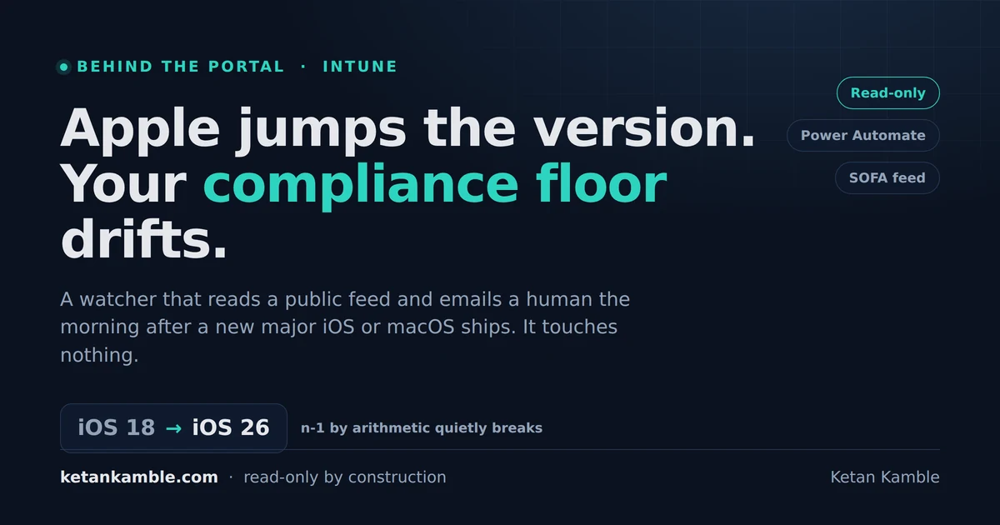

# When Apple jumps a version, your Intune compliance quietly drifts

{ .post-cover width="1200" height="630" fetchpriority=high }

We keep our Apple devices on an n-1 compliance line. Corporate devices have to be on the latest major iOS or one version behind it, personal devices one more back than that, and the same idea on macOS for the corporate ones. For years that was simple math. iOS 18 is out, so the floor is 17, and a quick check every September kept us honest.

Then Apple changed how it numbers things. iOS 18 didn't become iOS 19, it jumped straight to iOS 26. Any rule that worked out the floor by subtracting one from the current number was suddenly wrong, and a compliance policy can drift like that for weeks before anyone notices, usually when a device that should have been blocked quietly is not. This is the small automation we built so we stop finding out late.

<!-- more -->

<div class="hook-embed" markdown="0">
<iframe scrolling="no" src="/assets/hooks/apple-os-release-watch.html" title="Before and after: a new major Apple OS ships and the n-1 compliance floor silently falls behind; a read-only watcher catches the release overnight and emails a human the next morning to raise the Intune minimum" loading="lazy" style="display:block;width:100%;aspect-ratio:1200/470;border:0;border-radius:16px;box-shadow:0 10px 30px rgba(0,0,0,.35)"></iframe>
</div>

!!! success "The payoff"
    Apple moved to year-based version numbers in 2025, iOS 18 jumped straight to iOS 26 and macOS went to 26 as well, so any n-1 compliance rule that did arithmetic broke. This is a scheduled Power Automate flow that reads the public SOFA feed each morning, and the day after Apple ships a new major iOS or macOS it emails the service desk to update the Intune OS-version compliance policies and the enrollment restriction. It holds no Intune permissions and changes nothing. Updating the policy stays a human change.

## The version jump that broke the math

Our standard is n-1 for corporate and n-2 for personal. On iOS and iPadOS that means corporate devices sit on the newest major or the one before it, and personal devices can be one more version back. On macOS we hold the corporate line at n-1 and personal macOS is out of scope for us now.

The way most people encode that is arithmetic. Current major is 18, so corporate floor is 17, personal floor is 16, done. That worked right up until June 2025, when Apple announced it was aligning the version number to the year and the next release skipped from 18 straight to [iOS 26](https://www.macrumors.com/roundup/ios-26/), with macOS becoming 26 as well. There was no 19 through 25. Subtracting one from 26 does not give you the real previous major, so a rule built on arithmetic now points the floor at a version that never shipped, and the policy stops meaning what you think it means.

So we stopped doing arithmetic. The newest three majors are whatever the feed lists as the newest three, in order, and we read them by position rather than by subtracting.

## Why a watcher, and why it only reads and emails

The job here is not to change the compliance policy. It is to not miss the morning when it needs changing. Those are two different things, and only the first one is safe to automate without anyone looking.

So the flow does the small, safe half. It reads a public release feed and, the day after a new major ships, it emails the people who own the policy. It has no Intune permissions, no Graph scopes, no connection to the tenant at all. It can't touch a compliance policy even if the logic is wrong, because it was never given the ability to. The actual policy change stays a manual step that goes through its own review, where a human decides on the grace period and who gets warned first. Give the automation the signal, never the systems.

## The feed, and the one you cannot use

The data comes from the [SOFA feed](https://sofafeed.macadmins.io), a community-run, public JSON feed maintained by the macadmins community. There are two files, one for iOS and iPadOS and one for macOS:

```text
https://sofafeed.macadmins.io/v1/ios_data_feed.json
https://sofafeed.macadmins.io/v1/macos_data_feed.json
```

Inside each, `OSVersions[0]` is the newest major, `[1]` is n-1 and `[2]` is n-2. We read by that position on purpose. Because Apple jumped the numbers, the only reliable way to say "one major back" is to take the next item in a list that is already sorted newest first, not to do math on the number itself.

A fair question is why not read Apple's own feed. Apple publishes one at `gdmf.apple.com/v2/pmv`, and we tried it first. In our testing the Power Automate HTTP action would not complete the call because that endpoint's certificate chains to an Apple root that the connector does not trust, and there is no option in the action to skip that check. The community SOFA feed serves over a normal, trusted certificate, so it just works. If you ever need an Apple-only source, the same logic runs fine as an Azure Automation runbook, where `Invoke-RestMethod -SkipCertificateCheck` is available, but for a feed that is only reporting public version numbers the SOFA source is the pragmatic choice.

## How it works

<div class="mermaid-live" markdown="0">
--8<-- "assets/diagrams/apple-os-release-watch.svg"
</div>

Once a day the flow wakes up, reads the two public feeds, and for each one works out the newest major and the proposed new floors. If the newest major's first release landed yesterday, it sends one email per platform to the service desk, which raises a ticket. If not, it does nothing and goes back to sleep. Nothing in that path can write to Intune.

## Building the flow

The shape is a daily recurrence, a small list of platforms, and a loop that reads each feed and decides whether today is the morning after a release.

```text
Recurrence (daily, 07:00 your timezone)
Platforms (Initialize variable, Array)
Apply to each  <- variables('Platforms')
   HTTP (GET)  <- items('Apply_to_each')?['url']
   NewMajor      (Compose)
   MinCorporate  (Compose)
   MinPersonal   (Compose)
   Condition
      If yes -> Send an email (V2) to the service desk mailbox, CC the EUC list
      If no  -> nothing
```

One licensing note before you build it. The HTTP action is a premium connector, so whoever owns the flow needs a Power Automate Premium licence. Everything else is standard.

The platforms are a small array so the same loop covers iOS and macOS without duplicating actions:

```json
[
  {"name":"iOS/iPadOS","short":"iOS","personal":true,"url":"https://sofafeed.macadmins.io/v1/ios_data_feed.json"},
  {"name":"macOS","short":"macOS","personal":false,"url":"https://sofafeed.macadmins.io/v1/macos_data_feed.json"}
]
```

`personal` has to be a real boolean, with no quotes around it. If you type it as `"true"` it is a string, every string is truthy, and the macOS email will start showing personal-device lines that should not be there.

## The expressions that do the work

Three Compose actions turn the feed into the three numbers the email needs. We take the major part only and format the floors as `X.0`, because Intune wants the minimum in `X.0` form, not the latest patch.

| Action | Expression |
|---|---|
| NewMajor | `first(split(body('HTTP')?['OSVersions'][0]?['Latest']?['ProductVersion'], '.'))` |
| MinCorporate | `concat(first(split(body('HTTP')?['OSVersions'][1]?['Latest']?['ProductVersion'], '.')), '.0')` |
| MinPersonal | `concat(first(split(body('HTTP')?['OSVersions'][2]?['Latest']?['ProductVersion'], '.')), '.0')` |

We read `ProductVersion` and not `OSVersion` on purpose. On the macOS feed the `OSVersion` field carries the marketing name, so you can get something like "Golden Gate 27" there, and splitting that on a dot doesn't give you a clean number. `ProductVersion` is the plain numeric one.

The condition is what keeps this to one email per release with no state to store anywhere:

```text
equals(
  formatDateTime(last(body('HTTP')?['OSVersions'][0]?['SecurityReleases'])?['ReleaseDate'], 'yyyy-MM-dd'),
  formatDateTime(addDays(utcNow(), -1), 'yyyy-MM-dd')
)
```

The last entry in `SecurityReleases` is the `.0` release of the newest major. The flow only fires when that date was yesterday, so each major release produces exactly one email per platform and we never have to remember what we already sent. Point releases like 27.0.1 or 27.1 don't trigger it, which is what we want, since a point release does not move the compliance floor.

## The email it sends

When it fires, the body is written so the person who gets it can act without going back to the feed. This is the sanitized version, adjust the signature and the object names to match your own naming:

```text
Hi Team,

A new major Apple OS release was detected in the last 24 hours. The Intune
compliance policies and enrollment restriction for this platform need to be
updated.

New release: @{items('Apply_to_each')?['name']} @{outputs('NewMajor')}
Release date: @{formatDateTime(last(body('HTTP')?['OSVersions'][0]?['SecurityReleases'])?['ReleaseDate'], 'yyyy-MM-dd')}

Proposed new minimum OS versions:
- Corporate devices (n-1): @{outputs('MinCorporate')}@{if(items('Apply_to_each')?['personal'], concat(decodeUriComponent('%0A'), '- Personal devices (n-2): ', outputs('MinPersonal')), '')}

Required actions:
1. Identify users on devices below the new minimum and tell them their device
   may become non-compliant.
2. Update the OS-version compliance policy (corporate n-1, and personal n-2 where
   that platform has personal devices) and the enrollment restriction.
3. Check the references before making changes:
   https://learn.microsoft.com/mem/intune/fundamentals/supported-devices-browsers
   https://aka.ms/intunewhatsnewtoday

This message was generated automatically by the Apple OS release watcher.

Regards,
Endpoint Management
```

The subject is one expression so it reads cleanly in an inbox and in a ticket queue:

```text
concat('New ', items('Apply_to_each')?['name'], ' ', outputs('NewMajor'), ' released, compliance policy update required')
```

That `if(...personal...)` block is why the platforms array carries the boolean. On iOS the email includes the personal line, on macOS it leaves it out, from the one template.

## How to test it, and how to revert

You don't want to wait for Apple to ship something to know the flow works. You can fake "yesterday" in the condition:

1. In the condition, change the `-1` in `addDays(utcNow(), -1)` to the number of days since the last real `.0` release. If the current major shipped 31 days ago, use `-31`.
2. Save, then run it manually. Expect one email per platform.
3. Change it back to `-1` and save. A manual run should now show the email step as Skipped.
4. If you tested against your own address, set the To and CC back to the service desk mailbox and the EUC list.

A Skipped email step, which Power Automate labels `ActionBranchingConditionNotSatisfied`, is the normal result on every ordinary day. That is the flow correctly deciding there was no release yesterday.

## Gotchas from the lab

- `personal` must be a boolean, not the string `"true"`. Get this wrong and macOS starts emailing personal-device lines it should not.
- Read `ProductVersion`, not `OSVersion`. The macOS feed puts the marketing name in `OSVersion`.
- Read by array position, not arithmetic. That is the entire reason this exists. After the 18 to 26 jump, subtracting one from the current number gives you a version that never shipped.
- If the flow is off or fails on the one morning after a release, that release is missed, because there is no stored state catching up later. Failed runs do show in the run history and notify the owner, so check it is healthy.
- The HTTP action is premium, so the owner needs a Power Automate Premium licence.
- Add a co-owner from your team. A flow tied to one person's account is a single point of failure the day that person is away or leaves.
- Confirm that an OS-version enrollment restriction is actually supported for macOS in the current Intune docs before you promise one, iOS and iPadOS are the safe ones.
- Android has no SOFA equivalent. If you want the same signal there, you would build it around security patch level and the Intune "What's new" page instead, which is a different design.

## Why this is the pattern

This is the same move we make with everything on this site. The automation reads public data and tells a human, and the thing that actually changes the tenant stays a human step with its own review. The watcher cannot raise a floor on the wrong version or lock people out, because it was never handed the keys to do either. It just makes sure we're in the room on the right morning.

## References, Microsoft and community documentation

- **SOFA, Simple Organized Feed for Apple software updates** (macadmins community): [sofafeed.macadmins.io](https://sofafeed.macadmins.io)
- **Supported operating systems and browsers in Intune** (Microsoft Learn): [learn.microsoft.com](https://learn.microsoft.com/mem/intune/fundamentals/supported-devices-browsers)
- **What's new in Microsoft Intune**: [aka.ms/intunewhatsnewtoday](https://aka.ms/intunewhatsnewtoday)
- **Use the HTTP premium connector in Power Automate** (Microsoft Learn): [learn.microsoft.com](https://learn.microsoft.com/power-automate/desktop-flows/premium-connectors)
- **iOS 26 and Apple's move to year-based version numbers** (MacRumors): [macrumors.com](https://www.macrumors.com/roundup/ios-26/)

<script type="application/ld+json">
{
  "@context": "https://schema.org",
  "@type": "FAQPage",
  "mainEntity": [
    {
      "@type": "Question",
      "name": "Why did Apple's version jump break my Intune compliance rule?",
      "acceptedAnswer": {
        "@type": "Answer",
        "text": "Many n-1 compliance rules work out the minimum version by subtracting one from the current major. In 2025 Apple moved to year-based numbering and iOS 18 jumped straight to iOS 26, skipping 19 through 25. Subtracting one from 26 points at a version that never shipped, so an arithmetic rule silently stops meaning what you intended. Read the previous major by its position in a newest-first list instead."
      }
    },
    {
      "@type": "Question",
      "name": "Can this Power Automate flow change my Intune compliance policies?",
      "acceptedAnswer": {
        "@type": "Answer",
        "text": "No. It only reads a public release feed and sends an email. It holds no Intune permissions and no Graph scopes, so it cannot change a compliance policy or an enrollment restriction. Updating the policy stays a manual change that goes through its own review."
      }
    },
    {
      "@type": "Question",
      "name": "Why use the SOFA feed instead of Apple's own feed?",
      "acceptedAnswer": {
        "@type": "Answer",
        "text": "Apple's feed at gdmf.apple.com chains to an Apple root certificate that the Power Automate HTTP action does not trust, and that action has no option to skip the certificate check. The community SOFA feed serves over a normally trusted certificate, so the call completes. For an Apple-only source you can run the same logic as an Azure Automation runbook, which supports Invoke-RestMethod -SkipCertificateCheck."
      }
    },
    {
      "@type": "Question",
      "name": "Does the flow need a premium Power Automate licence?",
      "acceptedAnswer": {
        "@type": "Answer",
        "text": "Yes. The HTTP action is a premium connector, so the flow owner needs a Power Automate Premium licence. The recurrence, variables, Compose actions, condition and email are all standard."
      }
    }
  ]
}
</script>

---

*Personal lab pattern. All examples use synthetic values, there is no real tenant, mailbox, policy or device here. Verify version behaviour and enrollment-restriction support in your own tenant. Independent content, not affiliated with, sponsored by, or endorsed by Microsoft or Apple. Microsoft, Intune and Power Automate are trademarks of the Microsoft group of companies, and Apple, iOS, iPadOS and macOS are trademarks of Apple Inc.*
