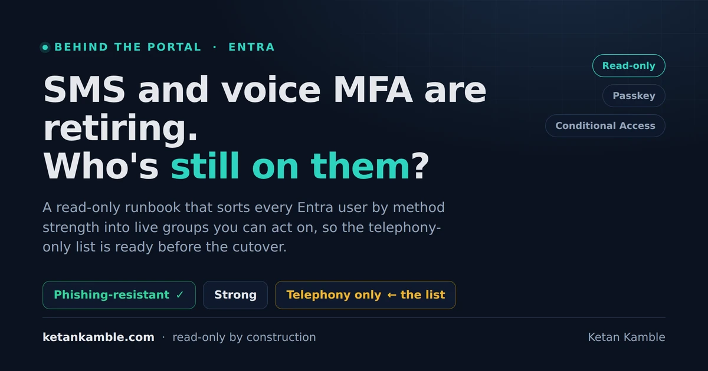

# Find phone-only Entra users before Microsoft-provided SMS and voice retires

{ .post-cover width="1200" height="630" fetchpriority=high }

Microsoft has put dates on retiring its own SMS and voice delivery for MFA, and the first question that comes up is who is still on a phone code. Microsoft's analyzer tells you if the tenant is in scope, this runbook tells you who, and keeps those people in Entra groups you can use for a registration campaign and for system-preferred authentication.

<!-- more -->

<div class="hook-embed" markdown="0">
<iframe scrolling="no" src="/assets/hooks/auth-method-readiness-groups.html" title="Before and after: authentication method registration data sitting flat, then sorted into live Entra groups per method strength, with the telephony-only group ready to target before Microsoft-provided SMS and voice retire" loading="lazy" style="display:block;width:100%;aspect-ratio:1200/470;border:0;border-radius:16px;box-shadow:0 10px 30px rgba(0,0,0,.35)">Before and after: a flat authentication-method registration report sorted into Entra readiness groups, with the telephony-only group as the migration list.</iframe>
</div>

!!! success "The payoff"
    One runbook puts every user into a group by the strongest sign-in method they have and keeps those groups current. The telephony-only group is your migration list, ready to target before the date.

## What's retiring, and when

Passkeys became the default on 1 September 2026. Microsoft stops delivering SMS and voice codes itself on 1 February 2027, and Global Administrators and external users follow on 1 July 2027 ([MC1426371](https://learn.microsoft.com/en-us/entra/identity/authentication/concept-sms-voice-retirement), [FAQ](https://learn.microsoft.com/en-us/entra/identity/authentication/concept-sms-voice-retirement-faq)). Internal guests stay on the February date with members, so the runbook keeps them in scope. The SMS and voice methods themselves aren't being removed, only Microsoft's delivery service for them. They keep working if you configure your own telephony provider through the Microsoft Security Store, which opens on 30 October 2026, and if you don't, anyone whose only method is a phone number loses their way in.

Microsoft's [entra-sms-voice-usage-analyzer](https://github.com/microsoft/entra-sms-voice-usage-analyzer) gives you a yes or no for the tenant. To act on it you need the people, so for every active user we take their strongest registered method and put them in one of four buckets:

- phishing-resistant: a passkey (device-bound or synced), FIDO2 key, Windows Hello for Business or platform credential
- strong: Authenticator push or passwordless, a one-time passcode, or third-party MFA like Duo
- telephony-only: SMS or voice is the only method, and this is the migration list
- nothing usable: no method, or only single-factor ones like email, security questions or a QR code with PIN

## Why a dynamic group can't do this

A dynamic membership rule only sees attributes on the user object, and registered methods come from a separate report, so there's no rule for "strongest method is a phone number". We hit the same gap with [app-based Entra groups](app-based-entra-groups.md). The answer is assigned groups you create once by hand, with the runbook keeping their membership in sync, which is the operational-groups idea. It only adds and removes members, it never creates, renames or deletes a group.

## Permissions

The runbook runs as an Azure Automation managed identity. Reading and classifying needs `User.Read.All`, `AuditLog.Read.All` and `GroupMember.Read.All`, and the registration report needs an Entra ID P1 or P2 licence. These are application permissions, and a managed identity has no consent button in the portal, so an admin assigns them as app roles with Microsoft Graph PowerShell, using `New-MgServicePrincipalAppRoleAssignment` as in [Microsoft's PowerShell guide for managed identities](https://learn.microsoft.com/en-us/entra/identity/managed-identities-azure-resources/assign-app-role-managed-identity-powershell), or with a Graph call. Changing membership needs `GroupMember.ReadWrite.All`, and that's the only write it can do. It starts as a dry run (GET calls only) and changes nothing until you set one parameter, so if you only want the lists, don't grant the write scope at all.

## How the runbook works

<div class="mermaid-live" markdown="0">
--8<-- "assets/diagrams/auth-method-readiness-groups.svg"
</div>

Each registered method maps to a class, and each user lands in one group by their strongest class:

```powershell
$MethodClassMap = @{
    'fido2SecurityKey'           = 'PhishingResistant'
    'passKeyDeviceBound'         = 'PhishingResistant'
    'passKeySynced'              = 'PhishingResistant'
    'windowsHelloForBusiness'    = 'PhishingResistant'
    'microsoftAuthenticatorPush' = 'Strong'
    'softwareOneTimePasscode'    = 'Strong'
    'externalAuthMethod'         = 'Strong'      # third-party MFA such as Duo
    'mobilePhone'                = 'Telephony'
    'email'                      = 'SsprOnly'    # password reset only
    'qrCodePin'                  = 'NotMfa'      # single-factor
    # ... full map in the runbook
}

$group =
    if     ($hasPR)               { 'PhishingResistant' }
    elseif ($hasStr)              { 'StrongNotPR' }
    elseif ($hasUnk)              { 'Review' }          # unrecognised value, a person decides
    elseif ($hasTel)              { 'TelephonyOnly' }   # the migration list
    elseif (-not $reg)            { 'NoRegistrationData' }
    elseif ($methods.Count -eq 0) { 'NoMfa' }
    elseif ($hasTap -and -not ($hasSspr -or $hasNotMfa)) { 'Review' }   # Temporary Access Pass only
    elseif ($hasNotMfa -or $hasSspr) { 'NoMfa' }        # QR code, email or questions only
    else                          { 'Review' }
```

A value that isn't in the map goes to Review, and the summary names it with a best guess so you can add it on purpose. That covers certificate values too, since certificate-based auth can be single-factor or multi-factor depending on your policy. A QR code with PIN is single-factor, so QR plus SMS lands in telephony-only.

Before it changes any membership, four gates have to pass:

- coverage: at least 90 percent of in-scope users need a registration row, or the run stops (keep `ExcludeDisabledAccounts` on, disabled users never get a row)
- partition: every classified user is in exactly one group
- removals: a user moving to a better group is always applied, but if too many people vanish from a group at once, those removals are skipped
- group shape: only plain cloud security groups, so on-premises-synced, role-assignable, mail-enabled and dynamic groups are left alone

Then it adds and removes members in Graph batches of 20 and writes a CSV of every change.

Before you switch to apply mode, export the current membership of the seven groups. If the classification or the coverage looks wrong after a run, set `DryRun` back to `$true`, and the change CSV lists every add and remove so you can put membership back by hand.

## What you get, and what each group is for

A run starts with the counts. These are synthetic numbers on a sample tenant:

```text
GroupKey             Members  NonHuman  ProposedName
PhishingResistant    1840     0         Auth - Phishing-resistant Method Users (CG)
StrongNotPR          2210     0         Auth - Strong Method Users (CG)
TelephonyOnly        430      22        Auth - Telephony Only Users (CG)
NoMfa                85       0         Auth - No Method Registered Users (CG)
NoRegistrationData   12       0         Auth - No Registration Data Users (CG)
Review               6        0         Auth - Manual Review Users (CG)
ExclusionNonHuman    22       22        Auth - Non-human Accounts Exclusion (CG)
```

Here that's 408 real people on phone codes once the 22 non-human accounts are taken out, and each run compares against the last one, so you can watch the number come down and get a warning if any group moves more than 15 percent in a day.

<div class="mermaid-live" markdown="0">
--8<-- "assets/diagrams/auth-method-readiness-groups-use.svg"
</div>

We use the groups in two places in the authentication methods policy. The telephony-only group is the include target of the registration campaign, so everyone in it gets nudged at sign-in to set up a passkey or Microsoft Authenticator, and with limited snoozes on they can skip it three times before they have to register. A campaign targets one method at a time, passkey or Microsoft Authenticator, so pick the one you want this group to land on. The phishing-resistant and strong groups are nested inside one parent, System Preferred MFA Users (CG), because system-preferred authentication takes only one include group, and pointing it at the parent means people who already have something stronger than a phone get asked for that instead of a code.

A registration campaign only asks people to register, it doesn't stop anyone signing in with SMS or voice. Once the telephony-only group is close to empty, enforce it with Conditional Access, using an authentication strength or phishing-resistant MFA for the apps that matter, and exclude your break-glass accounts and test them before you switch it on.

Non-human Accounts Exclusion (CG) works differently, it's an overlay. Service, shared, room, kiosk, system and test accounts stay in whatever method group they land in and are also added to this group, which is the exclude target of the registration campaign. Nobody sits behind those accounts to register a passkey or Authenticator, and once the snoozes run out the prompt can't be skipped, so a shared or kiosk account would get stuck on a registration screen. The runbook decides it from `employeeType` first, where Common, System and test mean non-human and Employee and Partner mean a person, and it only falls back to name patterns like svc or room when `employeeType` is empty or unmapped. Admin accounts are excluded the same way, and the summary has its own line for admins still on phone codes, so you move those on purpose and not through a nudge.

System-preferred authentication only changes which registered method Entra prompts for first. It doesn't remove SMS or voice and it doesn't guarantee a phishing-resistant sign-in, so someone whose only method is SMS still gets SMS, and if a user is in both the include and the exclude group, the exclude wins. Microsoft-managed system-preferred authentication covers all users by default, so scoping it to the parent is a choice to switch it on as people become ready. With the report lagging up to 36 hours, someone who registers a passkey today joins the parent a run or two later. A Power BI report on top of the CSVs is in the works.

## Gotchas from the lab

- The registration report can lag by up to 36 hours, so a passkey registered this morning can still show as telephony-only.
- Windows Hello for Business on one laptop counts as phishing-resistant, but it won't help that person on a phone browser. The runbook flags people whose only strong credential is tied to one machine. The practical fix for them is a passkey on their phone, in Microsoft Authenticator or as a synced passkey if your tenant allows them, or a FIDO2 security key if they sign in from mobile browsers a lot.
- Passkeys for internal guests start rolling out in late October 2026 and should be complete by late November 2026 ([MC1459133](https://mc.merill.net/message/MC1459133)). Microsoft Authenticator app passkeys are coming to internal guests but not to external users, and Microsoft hasn't announced the timing for external users yet. Until the rollout reaches your tenant, the registration campaign nudges guests for Authenticator rather than a passkey.
- The name-pattern fallback can catch real people. Short fragments like "sa" aren't checked against display names, but with `employeeType` empty a person signing in as sa.nguyen still lands in the exclusion group. `employeeType` always wins over the patterns, so filling it in for people is the fix.

## Get the complete runbook

Create the seven groups by hand, put your own storage names in (or leave the placeholders and skip the upload), grant the read scopes and run it with DryRun on. When the output looks right, schedule it daily in Azure Automation.

Pilot the registration campaign on a small group of telephony-only users first. Keep snoozes unlimited during the pilot and check the sign-in and registration logs, then turn on limited snoozes, which force registration after three skips, only once the group is stable.

After go-live, check weekly until the people count in the run summary reaches zero: the telephony-only membership, how many people completed registration through the campaign (the authentication methods registration report shows it), and, once you're enforcing, sign-ins that failed on Conditional Access in the sign-in logs, either blocked by a policy (error 53003) or because the user had no method that meets the required authentication strength. That people count already leaves out non-human accounts, which stay in the group by design.

[:material-file-code: The complete runbook and setup](../../scripts/auth-method-readiness-groups.md){ .md-button .md-button--primary } [:material-github: Runbook on GitHub](https://github.com/KetanKamble3894/zero-access-agent/blob/main/scripts/Report-AuthMethodReadiness.ps1){ .md-button }

## Questions people ask

**When is Microsoft-provided SMS and voice MFA retiring?**
On 1 February 2027 for most users and 1 July 2027 for Global Administrators and external users. You can keep SMS and voice by configuring your own telephony provider from 30 October 2026.

**How do I find users who only have SMS or voice MFA?**
Read `userRegistrationDetails` from Microsoft Graph and take each user's strongest method from `methodsRegistered`. This runbook does that and keeps the phone-only users in a group.

**Can a dynamic group target users by their authentication method?**
No, membership rules only see user attributes and methods come from the registration report, so you need assigned groups kept in sync by automation.

**Which groups should the registration campaign and system-preferred authentication target?**
Include the telephony-only group in the registration campaign and the parent of the phishing-resistant and strong groups in system-preferred authentication, and exclude the non-human accounts group from the registration campaign. System-preferred authentication takes only one include group, which is why the two are nested under a parent.

**Does this runbook change anything in my tenant?**
Not by default. It starts as a dry run, and when you turn that off it only changes membership of groups you created, after four gates pass.

## References

- [MC1426371](https://mc.merill.net/message/MC1426371), Passkeys by default and retirement of Microsoft-provided SMS and voice (message center)
- [SMS and voice retirement](https://learn.microsoft.com/en-us/entra/identity/authentication/concept-sms-voice-retirement) and its [FAQ](https://learn.microsoft.com/en-us/entra/identity/authentication/concept-sms-voice-retirement-faq) (Microsoft Learn, the authoritative dates)
- [MC1519855](https://mc.merill.net/message/MC1519855), Choose your own telephony provider for SMS and voice (message center)
- [MC1459133](https://mc.merill.net/message/MC1459133), Passkey support for B2B users, including the internal-guest rollout dates (message center)
- [entra-sms-voice-usage-analyzer](https://github.com/microsoft/entra-sms-voice-usage-analyzer) (Microsoft, tells you if the tenant is in scope)
- [Authentication methods activity](https://learn.microsoft.com/en-us/entra/identity/authentication/howto-authentication-methods-activity) (P1 or P2 licence, 36-hour latency) and [userRegistrationDetails](https://learn.microsoft.com/en-us/graph/api/resources/userregistrationdetails) (Microsoft Graph)
- [Registration campaign](https://learn.microsoft.com/en-us/entra/identity/authentication/how-to-mfa-registration-campaign) for a passkey or Microsoft Authenticator (Microsoft Learn)
- [System-preferred authentication](https://learn.microsoft.com/en-us/entra/identity/authentication/concept-system-preferred-authentication) and [QR code authentication](https://learn.microsoft.com/en-us/entra/identity/authentication/concept-authentication-qr-code) (Microsoft Learn)
- [Operational groups in Entra](https://entra.news/p/operational-groups-in-entra-with) (entra.news, related reading)

<script type="application/ld+json">
{
  "@context": "https://schema.org",
  "@type": "FAQPage",
  "mainEntity": [
    {
      "@type": "Question",
      "name": "When is Microsoft-provided SMS and voice MFA retiring?",
      "acceptedAnswer": {
        "@type": "Answer",
        "text": "On 1 February 2027 for most users and 1 July 2027 for Global Administrators and external users. You can keep SMS and voice by configuring your own telephony provider from 30 October 2026."
      }
    },
    {
      "@type": "Question",
      "name": "How do I find users who only have SMS or voice MFA?",
      "acceptedAnswer": {
        "@type": "Answer",
        "text": "Read userRegistrationDetails from Microsoft Graph and take each user's strongest method from methodsRegistered. This runbook does that and keeps the phone-only users in a group."
      }
    },
    {
      "@type": "Question",
      "name": "Can a dynamic group target users by their authentication method?",
      "acceptedAnswer": {
        "@type": "Answer",
        "text": "No, membership rules only see user attributes and methods come from the registration report, so you need assigned groups kept in sync by automation."
      }
    },
    {
      "@type": "Question",
      "name": "Which groups should the registration campaign and system-preferred authentication target?",
      "acceptedAnswer": {
        "@type": "Answer",
        "text": "Include the telephony-only group in the registration campaign and the parent of the phishing-resistant and strong groups in system-preferred authentication, and exclude the non-human accounts group from the registration campaign. System-preferred authentication takes only one include group, which is why the two are nested under a parent."
      }
    },
    {
      "@type": "Question",
      "name": "Does this runbook change anything in my tenant?",
      "acceptedAnswer": {
        "@type": "Answer",
        "text": "Not by default. It starts as a dry run, and when you turn that off it only changes membership of groups you created, after four gates pass."
      }
    }
  ]
}
</script>

---

*Personal lab pattern. All examples use synthetic values, there is no real tenant, user or storage account here. Verify authentication-method behaviour and the retirement dates in your own tenant and on Microsoft Learn. Independent content, not affiliated with, sponsored by, or endorsed by Microsoft. Microsoft, Entra, Microsoft Graph and Azure are trademarks of the Microsoft group of companies.*
