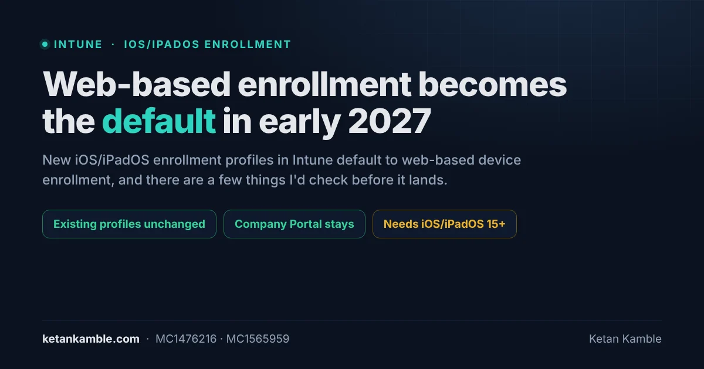

# Web-based iOS/iPadOS enrollment becomes the Intune default in early 2027

{ .post-cover width="1200" height="630" fetchpriority=high }

If you enroll personal iPhones and iPads in Intune, the starting point is moving away from the Company Portal app. Microsoft updates the web-based enrollment flow in late January 2027, and from early 2027 web-based enrollment is the default when you create a new iOS/iPadOS enrollment profile. Existing profiles aren't touched and Company Portal isn't being deprecated on iOS/iPadOS. Before then I'd look at Microsoft Authenticator, the SSO extension policy for Just-in-Time registration, and any personal iPhones or iPads still below iOS/iPadOS 15.

Microsoft announced it on the Intune Customer Success blog on 23 November 2026, and the details are in MC1476216 for the new default and MC1565959 for the updated flow.

<!-- more -->

<div class="hook-embed" markdown="0">
<iframe scrolling="no" src="/assets/hooks/ios-web-based-enrollment-default.html" title="Today a personal iPhone enrollment starts in the Company Portal app. From early 2027, new iOS/iPadOS enrollment profiles default to web-based enrollment, started from Teams, Outlook or Safari with the aim of one sign-in prompt, and existing profiles stay as they are" loading="lazy" style="display:block;width:100%;aspect-ratio:1200/470;border:0;border-radius:16px;box-shadow:0 10px 30px rgba(0,0,0,.35)"></iframe>
</div>

## The new flow first, then the new default

### The updated web-based flow, late January 2027 (MC1565959)

MC1565959 dates the updated flow to late January 2027, the blog is less exact and says early 2027. Users can start enrollment from Teams or Outlook, or from an enrollment URL in Safari, and guided steps take them through enrolling, installing the management profile, finishing registration and getting back to the work app. The update only reaches tenants already using a web-based profile.

Device registration happens through Just-in-Time (JIT) registration, using Microsoft Authenticator and the Microsoft Entra ID SSO extension, and the idea is that users get one sign-in prompt during enrollment.

### Web-based becomes the default, early 2027 (MC1476216)

From early 2027, web-based enrollment is the default when you create a new iOS/iPadOS enrollment profile, and existing profiles aren't affected. The no-profile case is less clear. The blog reads as if any tenant without a profile gets web-based enrollment, but the message center post only says that for new tenants that haven't created an enrollment profile.

Company Portal stays. It's still there after enrollment and you can keep deploying it as a required or available app.

Safari is the only supported browser for this kind of enrollment, Learn says it's needed to download the management profile and finish enrolling. The flow also still goes through the Company Portal website, so users don't need the app but the website is still part of it.

## Who will notice

- Admins who create new iOS/iPadOS enrollment profiles after the change lands.
- New tenants without an iOS/iPadOS enrollment profile.
- Help desks and onboarding guides, because the steps users see will look different. MC1565959 says there's nothing for admins to do, but you may need to update what you tell users.

I didn't see any licensing change in the blog or either message center post. On the message center archive I follow, both posts have only shown up in Education tenants so far, which it says could mean licensing or just a rollout that hasn't reached other tenants yet. Check Message center in your own tenant.

## What I'd check before web-based becomes the default

1. **Your enrollment profiles.** List your iOS/iPadOS enrollment type profiles with their default enrollment type, priority and assignments. Intune applies them in priority order, so if a user is assigned more than one profile, the higher priority profile wins.
2. **Microsoft Authenticator.** Microsoft recommends deploying it as a required app for users who enroll iOS/iPadOS devices. The device isn't ready for work until Authenticator is on it, and that can take a few minutes.
3. **The SSO extension policy for JIT.** MC1476216 says you need this policy for web enrollment, without JIT registration and Authenticator users may not be able to finish device registration and get to protected company resources. Set the `device_registration` key to `{{DEVICEREGISTRATION}}`, and Learn also recommends `browser_sso_interaction_enabled` set to `1`. Watch for trailing spaces around keys or values, they break JIT registration, and don't add Microsoft apps to the policy, Authenticator included.
4. **Conditional Access.** Microsoft recommends setting it up consistently for enrollment. Review your policies before the new flow reaches users.
5. **OS versions.** Web-based enrollment needs iOS/iPadOS 15 or later. If a web-based profile reaches a device on 14.9 or earlier, Intune enrolls it with app-based device enrollment instead, and that needs the Company Portal app. I keep an [Apple OS release watch](apple-os-release-watch.md) if you want to follow which versions are current.
6. **Safari.** If people use a different default browser, tell them to open the enrollment link in Safari.

## A read-only script to see where you stand

This lists your iOS/iPadOS enrollment type profiles and any personal iPhones or iPads still below 15.0. It doesn't change anything, same as my [read-only Intune Suite audit](intune-suite-read-only-audit.md). The profile endpoint is Graph beta, and beta endpoints change more often, I wouldn't build anything permanent on it.

```powershell
# Read-only. Lists iOS/iPadOS enrollment type profiles and personal iPhones/iPads below version 15.
# Needs the Microsoft.Graph.Authentication module. The profile endpoint is Graph beta, which can change.
Set-StrictMode -Off   # Graph responses can leave out keys, so a strict profile shouldn't break the run
Connect-MgGraph -Scopes 'DeviceManagementServiceConfig.Read.All','DeviceManagementManagedDevices.Read.All' -NoWelcome

function Get-GraphAll([string]$Uri) {
    $items = @()
    while ($Uri) {   # follows @odata.nextLink until there's none (a server repeating the same link would still loop)
        $page   = Invoke-MgGraphRequest -Method GET -Uri $Uri -ErrorAction Stop   # stop on errors, don't loop
        if ($page.value) { $items += $page.value }
        $Uri    = $page.'@odata.nextLink'
    }
    $items
}

# 1. iOS/iPadOS enrollment type profiles, highest priority first (0 is highest)
#    The platform enum has no separate iPadOS value, so this filters on iOS.
$base     = 'https://graph.microsoft.com/beta/deviceManagement/appleUserInitiatedEnrollmentProfiles'
$profiles = @(Get-GraphAll $base | Where-Object { $_.platform -eq 'iOS' } | Sort-Object { $_.priority })
if ($profiles.Count -eq 0) { 'No iOS/iPadOS enrollment type profile found.' }
$profiles | ForEach-Object {
    [pscustomobject]@{
        Profile     = $_.displayName
        Priority    = $_.priority
        DefaultType = $_.defaultEnrollmentType   # webDeviceEnrollment means web-based
        Assignments = @(Get-GraphAll "$base/$($_.id)/assignments").Count
    }
} | Format-Table -AutoSize

# 2. Personal iPhones and iPads below 15.0. A web-based profile sends devices on 14.9 or earlier
#    to app-based enrollment, which needs Company Portal.
$apple = Get-GraphAll 'https://graph.microsoft.com/v1.0/deviceManagement/managedDevices' |
    Where-Object { $_.operatingSystem -in 'iOS', 'iPadOS' -and $_.managedDeviceOwnerType -eq 'personal' }
$below15 = @(); $unread = @()
foreach ($d in $apple) {
    $v = $null
    if (-not [version]::TryParse($d.osVersion, [ref]$v)) { $unread += $d; continue }
    if ($v -lt [version]'15.0') { $below15 += $d }
}
$row = { [pscustomobject]@{ Device = $_.deviceName; OS = $_.operatingSystem; Version = $_.osVersion; User = $_.userPrincipalName } }
$below15 | ForEach-Object $row | Format-Table -AutoSize
if (-not $below15) { 'No personal iOS/iPadOS devices below 15.0 found.' }
if ($unread) {
    "Couldn't read the OS version on $($unread.Count) device(s), check these by hand:"
    $unread | ForEach-Object $row | Format-Table -AutoSize
}
```

It only asks for read permissions, the least privileged ones the Graph docs list for these calls. Assignments are read per profile from `/assignments`, since the list call's docs don't mention `$expand`. Learn doesn't say how iPads show up in the profile or the device data, so the profile check filters on `iOS`, there's no separate iPadOS value, and the device check matches both `iOS` and `iPadOS`. I filter in PowerShell instead of using `$filter` or `$select`, so it's a bigger download but there's less to go wrong. Devices whose OS version can't be read get their own list so you can check them by hand.

It turns strict mode off for its own run and stops on the first Graph error. Run it as a `.ps1` file, if you paste it into an open console the strict mode change stays in that session.

I tested it against mock Graph responses, things like paging, empty results, a device on exactly 15.0 and a failed call, but not against a live tenant, so try it in a test tenant first.

If part 1 comes back empty, you have no iOS/iPadOS enrollment type profile. The message center post only covers new tenants in that state, so in an existing tenant I'd create a profile on purpose rather than wait to see what the default does.

## Questions people ask

**Is Company Portal being deprecated on iOS/iPadOS?**
No, it stays. You just don't start web-based enrollment from it, and you can still deploy it as a required or available app.

**When does web-based enrollment become the default in Intune?**
From early 2027, for new iOS/iPadOS enrollment profiles (MC1476216). Existing profiles aren't affected. The updated web-based experience comes first, in late January 2027 (MC1565959).

**Which iOS versions support web-based device enrollment?**
iOS/iPadOS 15 or later. Devices on 14.9 or earlier that get a web-based profile are enrolled with app-based device enrollment, which needs the Company Portal app.

## Sources

- [Use web-based device enrollment for BYOD enrollment on iOS/iPadOS](https://techcommunity.microsoft.com/blog/intunecustomersuccess/use-web-based-device-enrollment-for-byod-enrollment-on-iosipados/4576027), Rishita Sarin, Intune Customer Success blog, 23 November 2026
- [MC1476216, Web based device enrollment will become default method for iOS/iPadOS device enrollment](https://mc.merill.net/message/MC1476216), message center
- [MC1565959, Updated web-based device enrollment experience for iOS/iPadOS](https://mc.merill.net/message/MC1565959), message center
- [Set up web based device enrollment](https://learn.microsoft.com/en-us/intune/device-enrollment/apple/setup-web-based-ios), Microsoft Learn
- [Set up Just-in-Time registration](https://learn.microsoft.com/en-us/intune/device-enrollment/apple/setup-just-in-time-registration), Microsoft Learn
- [appleUserInitiatedEnrollmentProfile resource type (beta)](https://learn.microsoft.com/en-us/graph/api/resources/intune-enrollment-appleuserinitiatedenrollmentprofile?view=graph-rest-beta), Microsoft Graph
- [List appleUserInitiatedEnrollmentProfiles (beta)](https://learn.microsoft.com/en-us/graph/api/intune-enrollment-appleuserinitiatedenrollmentprofile-list?view=graph-rest-beta), Microsoft Graph
- [List appleEnrollmentProfileAssignments (beta)](https://learn.microsoft.com/en-us/graph/api/intune-enrollment-appleenrollmentprofileassignment-list?view=graph-rest-beta), Microsoft Graph
- [List managedDevices](https://learn.microsoft.com/en-us/graph/api/intune-devices-manageddevice-list?view=graph-rest-1.0), Microsoft Graph
- [managedDevice resource type](https://learn.microsoft.com/en-us/graph/api/resources/intune-devices-manageddevice?view=graph-rest-1.0), Microsoft Graph
- [Invoke-MgGraphRequest](https://learn.microsoft.com/en-us/powershell/module/microsoft.graph.authentication/invoke-mggraphrequest) and [Connect-MgGraph](https://learn.microsoft.com/en-us/powershell/module/microsoft.graph.authentication/connect-mggraph), Microsoft Graph PowerShell

<script type="application/ld+json">
{
  "@context": "https://schema.org",
  "@type": "FAQPage",
  "mainEntity": [
    {"@type": "Question", "name": "Is Company Portal being deprecated on iOS/iPadOS?", "acceptedAnswer": {"@type": "Answer", "text": "No, it stays. You just don't start web-based enrollment from it, and you can still deploy it as a required or available app."}},
    {"@type": "Question", "name": "When does web-based enrollment become the default in Intune?", "acceptedAnswer": {"@type": "Answer", "text": "From early 2027, for new iOS/iPadOS enrollment profiles (MC1476216). Existing profiles aren't affected. The updated web-based experience comes first, in late January 2027 (MC1565959)."}},
    {"@type": "Question", "name": "Which iOS versions support web-based device enrollment?", "acceptedAnswer": {"@type": "Answer", "text": "iOS/iPadOS 15 or later. Devices on 14.9 or earlier that get a web-based profile are enrolled with app-based device enrollment, which needs the Company Portal app."}}
  ]
}
</script>

---

*Personal write-up. All examples use synthetic values, there's no real tenant, user or device here. Dates and behaviour are as Microsoft published them in November 2026 and can change, so check the sources before you plan around them. Independent content, not affiliated with, sponsored by, or endorsed by Microsoft or Apple. Microsoft, Intune, Entra, Teams, Outlook and Authenticator are trademarks of the Microsoft group of companies, and Apple, iPhone, iPad, iOS, iPadOS and Safari are trademarks of Apple Inc.*
